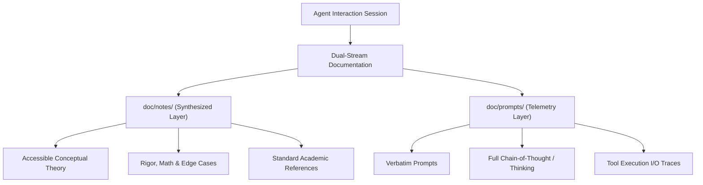
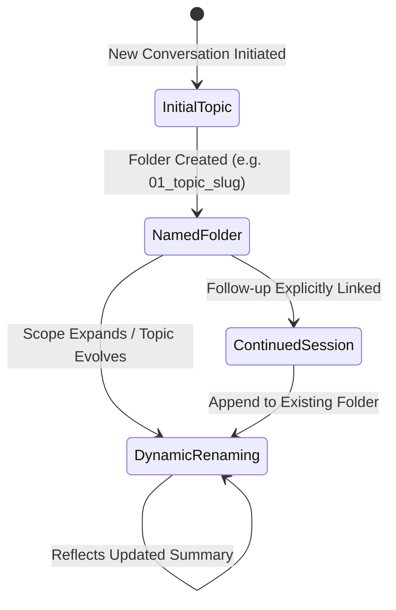

# Study Notes: Agent Conversation Archival & Study Documentation Protocol

---

## 1. Overview & Objective

Autonomous and semi-autonomous coding agents (such as LLM-based pair programmers) frequently make decisions, evaluate alternative approaches, inspect environments, and execute modifications. In complex research and software engineering environments—such as machine learning research laboratories—knowledge loss is a primary failure mode:

- **Context Eviction / Forgetting**: As conversations grow or new sessions start, vital contextual history, decisions, and problem analyses risk being forgotten or compacted into lossy summaries.
- **Opacity of Chain-of-Thought**: Without capturing the model's intermediate reasoning, post-hoc analysis of why a particular architecture, hyperparameter, or bug fix was chosen becomes difficult or impossible.
- **Disconnection Between Theory and Implementation**: Pure chat transcripts often lack educational structuring, making it tedious for human researchers or future agents to quickly extract high-level theory, equations, and literature references.

### Core Objective
The **Agent Documentation Protocol** resolves this by enforcing a dual-layer documentation system:
1. **`doc/notes/` (Educational / Synthesized Knowledge Layer)**: Translates interactions into structured, accessible, yet rigorous study notes containing theoretical foundations, code breakdowns, edge cases, and standard academic references.
2. **`doc/prompts/` (Verbatim Telemetry / Operational Layer)**: Captures complete, unedited transcripts of user prompts, agent thinking traces (Chain-of-Thought), tool invocations, and responses.

---

## 2. Key Concepts & Theoretical Foundations



### A. Dual-Track Memory Architecture in LLM Agents
In modern cognitive and agent architectures (e.g., Generative Agents, Reflexion, ReAct), agents benefit from splitting short-term execution logs from synthesized, semantic long-term memory:

| Dimension | Telemetry Stream (`doc/prompts/`) | Synthesized Knowledge Stream (`doc/notes/`) |
| :--- | :--- | :--- |
| **Cognitive Analog** | Episodic Memory & Working Trace | Semantic Memory & Knowledge Base |
| **Primary Audience** | Debugging, Auditing, Multi-agent Handover | Human Learners, Research Onboarding, Theory Review |
| **Content Fidelity** | Verbatim prompts, reasoning tokens, raw tool JSON | Plain-English explanations, LaTeX math, curated citations |
| **Evolution** | Append-only chronological records | Actively refined, structured reference guides |

### B. Chain-of-Thought (CoT) & ReAct Paradigms
- **Chain-of-Thought (Wei et al., 2022)**: Large Language Models perform substantially better on multi-step reasoning tasks when generating explicit intermediate reasoning steps before arriving at an answer.
- **ReAct: Synergizing Reasoning and Acting (Yao et al., 2022)**: interleaves reasoning traces (`Thinking / Planner Response`) with actions (`tool_calls`) and observations (`tool output`). Preserving both the thinking step and the tool output allows future review of whether an error was due to faulty reasoning (cognitive error) or faulty execution/environment failure (operational error).

### C. Literate Programming & Knowledge Externalization
Coined by Donald Knuth (1984), *Literate Programming* posits that code and documentation should form a unified narrative. In AI-assisted software engineering, this concept extends to **Agentic Traceability**: the agent does not merely commit code diffs, but documents *why* the diff was chosen, the trade-offs considered, and the foundational papers underlying the algorithms.

---

## 3. Implementation Details

### A. Directory Hierarchy
The project structure establishes a parallel, symmetrical folder convention under the root `doc/` path:

```text
Machine_Learning_Lab/
├── AGENTS.md                          # Global repository instruction rule
├── doc/
│   ├── notes/
│   │   └── 01_agent_documentation_protocol/
│   │       └── study_notes.md         # Synthesized theory, guides, & references
│   └── prompts/
│       └── 01_agent_documentation_protocol/
│           └── transcript_part1.md    # Verbatim transcripts & CoT traces
```

### B. Dynamic Naming and Evolution Lifecycle
Folders are named with an index and a descriptive slug reflecting their current contents (e.g., `01_agent_documentation_protocol`). 



- **Dynamic Renaming**: If a conversation about `01_linear_regression` expands into gradient descent variants and optimization theory, the folder name updates dynamically to `01_linear_regression_gradient_descent_optimization` across both `doc/notes/` and `doc/prompts/`.
- **Continuity Invariance**: Rather than fragmenting follow-ups across isolated directories, explicit continuations append to the existing topic folder, ensuring coherent historical threads.

### C. Standardized Note Layout Template
Every study note generated in `doc/notes/` follows a five-part anatomical layout:
1. **Overview / Objective**: High-level problem statement, purpose, and analogies.
2. **Key Concepts & Theoretical Foundations**: Mathematical definitions, algorithmic models, and architectural diagrams.
3. **Implementation Details**: Code explanations, parameter justifications, and step-by-step walkthroughs.
4. **Key Takeaways & Pitfalls**: Common edge cases, performance bottlenecks, and anti-patterns.
5. **References & Further Reading**: Authoritative literature citations (textbooks, arXiv papers, official docs).

---

## 4. Key Takeaways & Common Pitfalls

| Category | Best Practice | Common Pitfall / Anti-Pattern |
| :--- | :--- | :--- |
| **Language** | Use plain English, concrete analogies, and stepwise deductions before formalisms. | Masking lack of clarity with dense mathematical jargon without intuition. |
| **Archiving** | Preserve internal reasoning (`thinking`) unedited in collapsible details tags. | Stripping internal reasoning traces, preserving only final answers. |
| **Directory Parity**| Keep folder names identical between `doc/notes/` and `doc/prompts/`. | Diverging directory paths, creating orphan transcripts with no matching notes. |
| **Scope Expansion**| Rename folders when new subtopics substantially shift the focus. | Leaving legacy folder names that no longer reflect the expanded contents. |

---

## 5. References & Further Reading

1. **Wei, J., Wang, X., Schuurmans, D., Bosma, M., Chi, E., Le, Q., & Zhou, D. (2022)**. *Chain-of-thought prompting elicits reasoning in large language models*. Advances in Neural Information Processing Systems (NeurIPS 2022). [arXiv:2201.11903](https://arxiv.org/abs/2201.11903)
2. **Yao, S., Zhao, J., Yu, D., Du, N., Shafran, I., Narasimhan, K., & Cao, Y. (2022)**. *ReAct: Synergizing Reasoning and Acting in Language Models*. International Conference on Learning Representations (ICLR 2023). [arXiv:2210.03629](https://arxiv.org/abs/2210.03629)
3. **Park, J. S., O'Brien, J. C., Cai, C. J., Morris, M. R., Liang, P., & Bernstein, M. S. (2023)**. *Generative Agents: Interactive Simulacra of Human Behavior*. ACM Symposium on User Interface Software and Technology (UIST 2023). [arXiv:2304.03442](https://arxiv.org/abs/2304.03442)
4. **Shinn, N., Cassano, F., Gopinath, A., Narasimhan, K., & Yao, S. (2023)**. *Reflexion: Language Agents with Verbal Reinforcement Learning*. Advances in Neural Information Processing Systems (NeurIPS 2023). [arXiv:2303.11366](https://arxiv.org/abs/2303.11366)
5. **Knuth, D. E. (1984)**. *Literate Programming*. The Computer Journal, 27(2), 97-111. [DOI: 10.1093/comjnl/27.2.97](https://doi.org/10.1093/comjnl/27.2.97)
