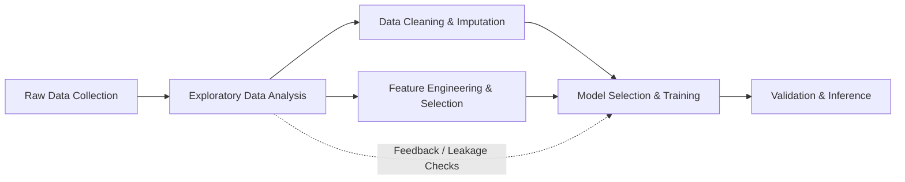
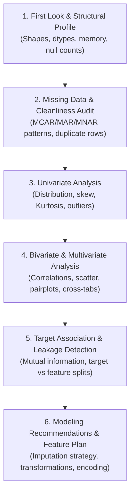

# Study Notes: Exploratory Data Analysis (EDA) in Machine Learning

---

## 1. Overview & Objective

In machine learning and statistics, **Exploratory Data Analysis (EDA)** is the foundational, investigative process of analyzing, summarizing, and visualizing datasets to discover their underlying structure, detect anomalies and outliers, test hypotheses, check statistical assumptions, and identify key relationships among features before constructing predictive models.

### Historical Context: From Confirmatory to Exploratory
Historically, statistics was dominated by **Confirmatory Data Analysis (CDA)**, centered around formal hypothesis testing, confidence intervals, and $p$-values. In 1977, statistician **John W. Tukey** published his seminal book, *Exploratory Data Analysis*, arguing that statisticians placed excessive emphasis on testing hypotheses before they actually understood the shape and nuances of their data. Tukey compared confirmatory analysis to a judicial trial, whereas exploratory data analysis is the detective work gathering clues:

> *"Exploratory data analysis is detective work... Unless the detective finds the clues, alternative candidates, or suspects, there is nothing for the jury to weigh and evaluate."*  
> — John W. Tukey (1977)

### Role in the End-to-End Machine Learning Pipeline
EDA is not an isolated preliminary ritual; it informs every downstream decision in the ML lifecycle:
- **Feature Engineering & Transformation**: Identifies skewed distributions that require logarithmic, Box-Cox, or Yeo-Johnson power transformations; detects high-cardinality categorical features.
- **Handling Data Quality Issues**: Uncovers missing data mechanisms (MCAR, MAR, MNAR), corrupted records, duplicated samples, and measurement artifacts.
- **Algorithm Selection**: Highlights whether data is linearly separable, whether non-linear boundary algorithms (trees, kernel SVMs, neural networks) are required, or whether scale-sensitive models (k-NN, linear regression, SVMs) require normalization/standardization.
- **Preventing Failure Modes**: Catches **Target Leakage** (features containing post-outcome information) and the **Accuracy Paradox** (severe class imbalance).



---

## 2. Key Concepts & Theoretical Foundations

EDA operates across statistical domains, measuring central tendencies, spreads, multi-variable associations, and distributional geometries.

### A. Taxonomy of Feature Measurement Scales
Understanding the scale of measurement determines which statistical metrics and visualizations are mathematically valid:

| Scale | Definition | Mathematical Properties | Permissible Operations | Examples |
| :--- | :--- | :--- | :--- | :--- |
| **Nominal** (Categorical) | Discrete categories without intrinsic ordering | Equivalence ($=$ or $\neq$) | Mode, Frequency, Cross-tabulation, $\chi^2$ test | Country, Blood Type, Device OS |
| **Ordinal** (Categorical) | Categorical with a meaningful ranking or order | Ordering ($<, =, >$) | Median, Percentiles, Rank correlation (Spearman, Kendall) | Education Level, Rating (1–5 stars) |
| **Interval** (Numerical) | Numerical with uniform intervals, but no true absolute zero | Addition/Subtraction ($+,-$) | Mean, Standard Deviation, Pearson correlation | Temperature in Celsius/Fahrenheit, Calendar Year |
| **Ratio** (Numerical) | Numerical with uniform intervals and an absolute true zero | Multiplication/Division ($\times, \div$) | Geometric mean, Coefficient of variation, all standard math | Age, Income, Weight, Latency (ms) |

---

### B. Summary Statistics & Robustness

A fundamental tenet of EDA is selecting summary statistics that reflect the true data-generating process, particularly under skewed or contaminated conditions.

#### 1. Central Tendency & the Breakdown Point
The **breakdown point** of an estimator is the minimum proportion of arbitrarily contaminated observations that can cause the estimator to take an arbitrarily large or incorrect value.

- **Arithmetic Mean**:
  $$\mu = \frac{1}{N} \sum_{i=1}^N x_i$$
  Breakdown point = **0%**. A single outlier ($x_i \to \infty$) pulls the mean to infinity.
- **Median**:
  $$\text{Med}(X) = x_{(\lceil (N+1)/2 \rceil)}$$
  Breakdown point = **50%**. Half of the observations must be corrupted before the median breaks down.
- **Trimmed / Winsorized Mean**: Discards or caps the upper and lower $\alpha\%$ (e.g., 5%) of extreme values to balance efficiency and robustness.

#### 2. Measures of Dispersion
- **Standard Deviation & Variance**:
  $$\sigma^2 = \frac{1}{N-1}\sum_{i=1}^N (x_i - \bar{x})^2$$
  Breakdown point = **0%**. Sensitive to squared extreme errors.
- **Interquartile Range (IQR)**:
  $$\text{IQR} = Q_3 - Q_1$$
  where $Q_1$ is the 25th percentile and $Q_3$ is the 75th percentile. Breakdown point = **25%**.
- **Median Absolute Deviation (MAD)**:
  $$\text{MAD} = \text{median}(|x_i - \text{median}(X)|)$$
  Breakdown point = **50%**. A standard robust alternative to standard deviation.

---

### C. Distributional Shapes: Skewness, Kurtosis, & Normality

#### 1. Skewness ($\gamma_1$)
Measures the asymmetry of the probability distribution about its mean:
$$\gamma_1 = \mathbb{E}\left[ \left(\frac{X - \mu}{\sigma}\right)^3 \right] = \frac{\frac{1}{N}\sum_{i=1}^N (x_i - \bar{x})^3}{\left(\frac{1}{N}\sum_{i=1}^N (x_i - \bar{x})^2\right)^{3/2}}$$

- **$\gamma_1 = 0$**: Symmetric (e.g., Normal Distribution).
- **$\gamma_1 > 0$** (Right / Positive Skew): Long tail extends to the right; $\text{Mode} < \text{Median} < \text{Mean}$. Common in income, housing prices, server latency.
- **$\gamma_1 < 0$** (Left / Negative Skew): Long tail extends to the left; $\text{Mean} < \text{Median} < \text{Mode}$. Common in human lifespan, test scores on easy exams.

#### 2. Kurtosis ($\gamma_2$)
Measures "tailedness" and the likelihood of extreme values (fat tails):
$$\text{Excess Kurtosis} = \frac{\frac{1}{N}\sum_{i=1}^N (x_i - \bar{x})^4}{\sigma^4} - 3$$
- **Mesokurtic** ($\gamma_2 = 0$): Normal distribution tails.
- **Leptokurtic** ($\gamma_2 > 0$): Heavy tails, sharp peak, higher frequency of extreme outliers (e.g., financial market returns).
- **Platykurtic** ($\gamma_2 < 0$): Light tails, flat peak (e.g., uniform distribution).

#### 3. Quantile-Quantile (Q-Q) Plot
Compares the quantiles of empirical sample data against the theoretical quantiles of a known distribution (most commonly the standard normal distribution $\mathcal{N}(0, 1)$). If data points follow a straight line along the diagonal $y = x$, the empirical distribution matches the theoretical distribution. Deviations at the ends indicate skew or heavy tails.

---

### D. Bivariate & Multivariate Relationship Analysis

#### 1. Correlation Coefficients
- **Pearson Linear Correlation ($r$)**:
  $$r_{xy} = \frac{\sum (x_i - \bar{x})(y_i - \bar{y})}{\sqrt{\sum (x_i - \bar{x})^2 \sum (y_i - \bar{y})^2}} \in [-1, 1]$$
  Assumes linearity and bivariate normality. Vulnerable to outliers.
- **Spearman Rank Correlation ($\rho$)**:
  Computes Pearson correlation on the ranks of values ($r_{\text{rank}(x), \text{rank}(y)}$). Measures any **monotonic** relationship (whether linear or non-linear) and is robust to extreme values.
- **Kendall’s Tau ($\tau$)**:
  Based on concordant versus discordant pairs:
  $$\tau = \frac{C - D}{\frac{1}{2}N(N-1)}$$
  Smaller sample variance and better mathematical properties than Spearman for small sample sizes with ties.

#### 2. Categorical Associations
- **Chi-Square Test of Independence ($\chi^2$)**:
  $$\chi^2 = \sum \frac{(O_{ij} - E_{ij})^2}{E_{ij}}$$
  Tests whether two categorical variables are statistically independent based on contingency tables of observed ($O$) and expected ($E$) frequencies.
- **Cramér’s V**:
  Normalized measure of association between nominal variables:
  $$V = \sqrt{\frac{\chi^2}{N \min(r-1, c-1)}} \in [0, 1]$$

---

### E. Diagnostic Foundations: Outliers, Missingness, & Multicollinearity

#### 1. Missing Data Mechanisms (Rubin's Taxonomy, 1976)
- **MCAR (Missing Completely at Random)**: The probability of missingness is completely independent of both observed and unobserved data:
  $$P(M | Y_{\text{obs}}, Y_{\text{mis}}) = P(M)$$
  *Example*: A test tube drops and shatters accidentally. Safe to drop or impute without bias.
- **MAR (Missing at Random)**: The probability of missingness depends on observed features, but not on the missing value itself:
  $$P(M | Y_{\text{obs}}, Y_{\text{mis}}) = P(M | Y_{\text{obs}})$$
  *Example*: Men are less likely to disclose depression scores in a survey, but conditional on gender, missingness is random.
- **MNAR (Missing Not at Random / Non-Ignorable)**: Missingness depends directly on the unobserved value itself:
  $$P(M | Y_{\text{obs}}, Y_{\text{mis}}) \neq P(M | Y_{\text{obs}})$$
  *Example*: High-income earners refuse to disclose their salary. Simple mean/median imputation causes severe bias; requires pattern-mixture modeling or explicit missing indicators.

#### 2. Outlier Identification Methods
- **Tukey’s Fences**:
  $$\text{Inner Fences} = [Q_1 - 1.5 \times \text{IQR}, \; Q_3 + 1.5 \times \text{IQR}]$$
  $$\text{Outer Fences} = [Q_1 - 3.0 \times \text{IQR}, \; Q_3 + 3.0 \times \text{IQR}]$$
- **Modified Z-score** (using MAD):
  $$M_i = \frac{0.6745 \cdot (x_i - \text{median}(X))}{\text{MAD}}$$
  Values with $|M_i| > 3.5$ are labeled as potential outliers.
- **Mahalanobis Distance** (Multivariate Outliers):
  $$D_M(\mathbf{x}) = \sqrt{(\mathbf{x} - \boldsymbol{\mu})^T \boldsymbol{\Sigma}^{-1} (\mathbf{x} - \boldsymbol{\mu})}$$
  Accounts for the covariance structure ($\boldsymbol{\Sigma}$) between multiple features simultaneously.

#### 3. Multicollinearity & Variance Inflation Factor (VIF)
When two or more predictor features are highly collinear, parameter estimates in linear and generalized linear models become unstable with inflated standard errors:
$$\text{VIF}_j = \frac{1}{1 - R_j^2}$$
where $R_j^2$ is the coefficient of determination when regressing feature $x_j$ against all other features.
- $\text{VIF} = 1$: No collinearity.
- $\text{VIF} > 5$ to $10$: Severe multicollinearity; candidates for feature dropping, regularization (Ridge/L2), or PCA.

---

## 3. The EDA Workflow & Practical Implementation

A systematic EDA protocol progresses through six structured phases:



### Python Implementation Walkthrough

The following script demonstrates a complete, production-grade EDA pipeline using Python's standard data science ecosystem (`pandas`, `numpy`, `scipy`, `seaborn`, `matplotlib`):

```python
import numpy as np
import pandas as pd
import matplotlib.pyplot as plt
import seaborn as sns
from scipy import stats

def comprehensive_eda_pipeline(df: pd.DataFrame, target_col: str = None):
    """
    Executes a structured EDA audit on an input DataFrame.
    """
    print("=" * 60)
    print("PHASE 1: STRUCTURAL PROFILE")
    print("=" * 60)
    print(f"Dataset Shape: {df.shape[0]} rows, {df.shape[1]} columns")
    print(f"Total Memory Usage: {df.memory_usage().sum() / (1024**2):.2f} MB")
    print(f"Duplicate Rows: {df.duplicated().sum()}")
    print("\nData Types:")
    print(df.dtypes.value_counts())

    print("\n" + "=" * 60)
    print("PHASE 2: MISSING VALUE DIAGNOSTICS")
    print("=" * 60)
    null_counts = df.isnull().sum()
    null_pct = (null_counts / len(df)) * 100
    missing_summary = pd.DataFrame({"Missing_Count": null_counts, "Missing_Percent": null_pct})
    missing_summary = missing_summary[missing_summary["Missing_Count"] > 0].sort_values("Missing_Percent", ascending=False)
    if not missing_summary.empty:
        print(missing_summary)
    else:
        print("No missing values detected.")

    num_cols = df.select_dtypes(include=[np.number]).columns.tolist()
    cat_cols = df.select_dtypes(exclude=[np.number]).columns.tolist()
    if target_col and target_col in num_cols:
        num_cols.remove(target_col)
    elif target_col and target_col in cat_cols:
        cat_cols.remove(target_col)

    print("\n" + "=" * 60)
    print("PHASE 3: UNIVARIATE STATISTICAL AUDIT (NUMERICAL)")
    print("=" * 60)
    stats_list = []
    for col in num_cols:
        series = df[col].dropna()
        q1 = series.quantile(0.25)
        q3 = series.quantile(0.75)
        iqr = q3 - q1
        lower_fence = q1 - 1.5 * iqr
        upper_fence = q3 + 1.5 * iqr
        outliers_count = ((series < lower_fence) | (series > upper_fence)).sum()

        stats_list.append({
            "Feature": col,
            "Mean": series.mean(),
            "Std": series.std(),
            "Median": series.median(),
            "IQR": iqr,
            "Skewness": stats.skew(series),
            "Kurtosis": stats.kurtosis(series),
            "Outliers_IQR": outliers_count,
            "Outlier_Pct": (outliers_count / len(series)) * 100
        })
    stats_df = pd.DataFrame(stats_list)
    print(stats_df.to_string(index=False))

    print("\n" + "=" * 60)
    print("PHASE 4: CATEGORICAL CARDINALITY AUDIT")
    print("=" * 60)
    for col in cat_cols:
        n_unique = df[col].nunique()
        top_val = df[col].mode().iloc[0] if not df[col].empty else None
        top_freq = (df[col] == top_val).sum()
        print(f"Feature: {col:<20} Unique: {n_unique:<5} Top: {str(top_val):<15} Mode Freq: {top_freq} ({(top_freq/len(df))*100:.1f}%)")

    # PHASE 5: MULTIVARIATE CORRELATIONS
    if len(num_cols) > 1:
        corr_matrix = df[num_cols].corr(method='spearman')
        high_corr = []
        for i in range(len(num_cols)):
            for j in range(i + 1, len(num_cols)):
                c1, c2 = num_cols[i], num_cols[j]
                val = corr_matrix.loc[c1, c2]
                if abs(val) >= 0.70:
                    high_corr.append((c1, c2, val))
        
        print("\n" + "=" * 60)
        print("PHASE 5: MULTICOLLINEARITY SCAN (|Spearman rho| >= 0.70)")
        print("=" * 60)
        if high_corr:
            for c1, c2, val in high_corr:
                print(f"High collinearity between '{c1}' and '{c2}': rho = {val:.3f}")
        else:
            print("No pairwise correlations exceeding threshold 0.70.")

    # PHASE 6: TARGET ANALYSIS
    if target_col and target_col in df.columns:
        print("\n" + "=" * 60)
        print(f"PHASE 6: TARGET VARIABLE INSPECTION ('{target_col}')")
        print("=" * 60)
        if target_col in df.select_dtypes(include=[np.number]).columns:
            print(f"Target Type: Continuous (Regression)")
            print(f"Mean: {df[target_col].mean():.3f} | Median: {df[target_col].median():.3f} | Skew: {stats.skew(df[target_col].dropna()):.3f}")
        else:
            print(f"Target Type: Discrete (Classification)")
            val_counts = df[target_col].value_counts(normalize=True) * 100
            print(val_counts)
            min_class_ratio = val_counts.min()
            if min_class_ratio < 10.0:
                print(f"WARNING: Severe class imbalance detected! Minority class: {min_class_ratio:.2f}%")
```

---

## 4. Key Takeaways & Common Pitfalls

| Category | Best Practice | Dangerous Pitfall / Anti-Pattern |
| :--- | :--- | :--- |
| **Data Snooping & Leakage** | Always split data into **Train and Test sets before** fitting imputers, encoders, scalers, or performing outlier filtering. | Performing global transformations or target-guided encodings on the combined dataset prior to train/test splitting. |
| **Summary Statistics** | Always plot visual distributions alongside summary metrics. Inspect Anscombe’s Quartet and the Datasaurus Dozen. | Relying exclusively on Mean, Std, and Pearson $r$. Datasets with wildly disparate shapes (circles, dinosaurs, stars) can share identical summary numbers. |
| **Outlier Handling** | Investigate the origin of extreme points (data-entry error vs. true rare phenomenon). Treat with clipping, robust loss functions (Huber loss), or tree ensembles. | Blindly deleting all records outside $3\sigma$ or $1.5 \times \text{IQR}$. In fraud detection or rare disease diagnosis, the outliers *are* the targets. |
| **Correlation vs. Causation** | Use correlation to discover predictive signals, not causal mechanisms. Check for confounding variables and spurious correlations. | Assuming a high correlation indicates that altering feature $X$ will cause a direct change in target $Y$. |
| **Imputation Bias** | Verify missingness mechanisms (MCAR vs. MAR/MNAR). Add binary missingness indicator flags (`is_null`) when imputing MNAR data. | Applying simple mean or median replacement without analyzing missing patterns, distorting feature variances and correlations. |

---

## 5. References & Further Reading

### Foundational Texts
1. **Tukey, John W.** (1977). *Exploratory Data Analysis*. Addison-Wesley Publishing Company. ISBN: 978-0201076165. (The landmark work establishing EDA as an independent discipline).
2. **Bishop, Christopher M.** (2006). *Pattern Recognition and Machine Learning*. Springer. Chapter 1 & 2 (Probability distributions and density estimation).
3. **Géron, Aurélien** (2022). *Hands-On Machine Learning with Scikit-Learn, Keras, and TensorFlow* (3rd ed.). O'Reilly Media. Chapter 2: "End-to-End Machine Learning Project" (Practical EDA workflows).
4. **McKinney, Wes** (2022). *Python for Data Analysis: Data Wrangling with pandas, NumPy & Jupyter* (3rd ed.). O'Reilly Media.

### Seminal Research Papers
- **Rubin, Donald B.** (1976). "Inference and Missing Data". *Biometrika*, 63(3), 581–592. [DOI: 10.1093/biomet/63.3.581](https://doi.org/10.1093/biomet/63.3.581).
- **Anscombe, Francis J.** (1973). "Graphs in Statistical Analysis". *The American Statistician*, 27(1), 17–21. (Anscombe's Quartet demonstrating the imperative of graphical EDA).
- **Matejka, Justin, & Fitzmaurice, George** (2017). "Same Stats, Different Graphs: Generating Datasets with Varied Appearance and Identical Summary Statistics through Simulated Annealing". *ACM SIGCHI Conference on Human Factors in Computing Systems (CHI)*. [DOI: 10.1145/3025453.3025912](https://doi.org/10.1145/3025453.3025912).
